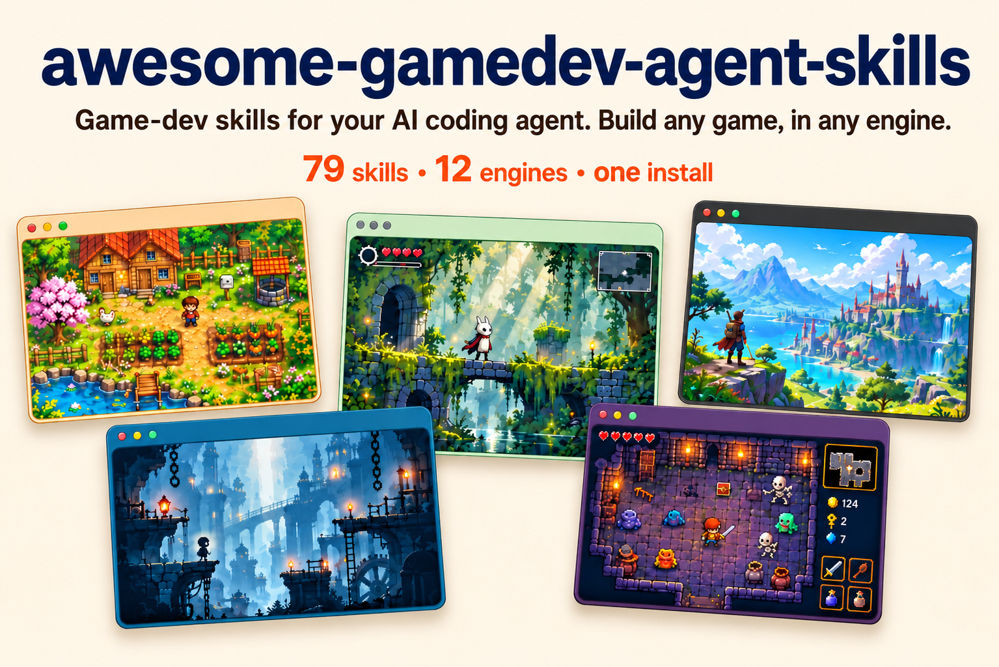
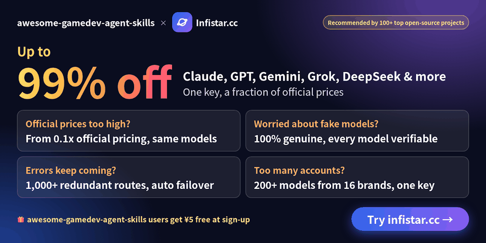

<!-- markdownlint-disable MD033 MD041 -->

# awesome-gamedev-agent-skills

<p align="center">
  
</p>

**Make games with your AI coding agent, in the engine you already use.** 79 skills for 12
engines: say what you're building, and a router loads the right 2 or 3 skills before your agent
writes code.

```bash
npx skills add gamedev-skills/awesome-gamedev-agent-skills
```

[](https://github.com/gamedev-skills/awesome-gamedev-agent-skills/releases/latest)
[](https://skills.sh/gamedev-skills/awesome-gamedev-agent-skills)
[](docs/VERSION-SUPPORT.md)
[](LICENSE)
[](skills/)
[](docs/SKILL-FORMAT.md)
[](https://github.com/gamedev-skills/awesome-gamedev-agent-skills/commits/main)
[](#sponsors)

[Agent Skills](docs/SKILL-FORMAT.md) are small capability files an AI agent loads only when it
needs them. This repo gives your agent **79 game-dev skills** and a **router** that picks the
right ones for you. You describe what you're building; the agent loads the matching engine and
task skills before it writes code.

- **Cross-engine.** Godot, Unity, Unreal, Ebitengine, Phaser, PixiJS, three.js, Bevy, pygame, LÖVE, Defold, Roblox.
- **You don't pick skills.** The router detects your engine and task and loads only what fits.
- **Art direction, not one-off generations.** The asset workflow locks a visual target, builds
  families, normalizes outputs deterministically, and checks them inside the game.
- **Checked on the real engines.** Every skill is written from official engine docs and pinned to
  a current release (Godot 4.7.2, Unity 6.3 LTS, Unreal 5.8, Phaser 4.2.1, three.js r187 and
  more, checked 2026-11-11). Code examples were run or compiled on the real toolchains for 10 of
  the 12 engines, and in 366 blind test prompts the right skill loaded for 98.7% of the requests
  that needed one. [Results, method and limits](evals/RESULTS.md) ·
  [version support](docs/VERSION-SUPPORT.md).

## Sponsors

<!-- Two sponsors per row. Banners are 960x480 PNGs in docs/assets/sponsors/. -->
<table>
  <tr>
    <td align="center" width="50%">
      <a href="https://www.infistar.cc/register?aff=59SNHZD6&amp;ref_source=link">
        
      </a>
      <br>
      <sub>Sponsored · <a href="https://www.infistar.cc/register?aff=59SNHZD6&amp;ref_source=link">Infistar</a></sub>
    </td>
    <td align="center" width="50%">
      <a href="mailto:abhishekbarali6969@gmail.com?subject=Sponsoring%20awesome-gamedev-agent-skills">
        
      </a>
      <br>
      <sub>Open slot · <a href="mailto:abhishekbarali6969@gmail.com?subject=Sponsoring%20awesome-gamedev-agent-skills">Become a sponsor</a></sub>
    </td>
  </tr>
</table>

Want to reach game developers who build with AI coding agents? Email
[abhishekbarali6969@gmail.com](mailto:abhishekbarali6969@gmail.com?subject=Sponsoring%20awesome-gamedev-agent-skills).
Sponsor slots are monthly. Sponsored entries are labelled as sponsored and have no effect on which
skills the router picks.

## Contents

- [Quick start](#quick-start)
- [What you can ask](#what-you-can-ask)
- [How the router picks skills](#how-the-router-picks-skills)
- [Catalog](#catalog)
- [Agent compatibility](#agent-compatibility)
- [Contributing](#contributing)

## Quick start

**One command, any agent.** The [`skills`](https://www.npmjs.com/package/skills) CLI detects the
coding agent you already use and installs the router plus all 79 skills into the right place:

```bash
npx skills add gamedev-skills/awesome-gamedev-agent-skills
```

Add `--list` to preview first, `-g` to install for every project, or `-a <agent>` to target a
specific tool (`-a cursor`, `-a claude-code`, `-a gemini-cli`, …). The CLI needs Node.js 22.20 or
later. The same `SKILL.md` files load
natively in Claude Code, Cursor, Windsurf, Cline, Codex, Gemini CLI, GitHub Copilot, Kiro, and
[dozens more](docs/COMPATIBILITY.md) — there's nothing to convert.

**Claude Code plugin (alternative).** This repo is also a Claude Code plugin marketplace, so you
can install it with Claude's own commands:

```bash
claude plugin marketplace add gamedev-skills/awesome-gamedev-agent-skills
claude plugin install gamedev@awesome-gamedev-agent-skills
```

Building in only one engine? Install a smaller bundle — `router` plus your engine:

```bash
claude plugin install router@awesome-gamedev-agent-skills
claude plugin install godot@awesome-gamedev-agent-skills    # or: unity · unreal · ebitengine · web-engines · other-engines
```

**Install tip.** If your agent already has many skills, install the router and your engine's
bundle instead of everything. Agents list every skill's description within a size limit, and
past that limit some descriptions are cut, which makes the right skill harder to pick. In Claude
Code the limit is 1% of the context window; raise it with the `skillListingBudgetFraction`
setting (for example `0.02`) or set a character count with the `SLASH_COMMAND_TOOL_CHAR_BUDGET`
environment variable ([Claude Code skills docs](https://code.claude.com/docs/en/skills)).

Prefer to copy the files by hand, or want the exact per-tool paths? See
**[`docs/INSTALLATION.md`](docs/INSTALLATION.md)**.

Want to read the catalog as web pages instead? Every skill, engine group, and per-agent install
path is browsable at
**[gamedev-skills.github.io/awesome-gamedev-agent-skills](https://gamedev-skills.github.io/awesome-gamedev-agent-skills/)**,
generated straight from the `SKILL.md` files in this repo.

Then just talk to your agent — see below.

## What you can ask

Describe the task in plain language. The router figures out the skills:

| You say | Skills it loads for you |
|---------|-------------------------|
| "add a double jump to my Godot player" | `godot-2d-movement` + `platformer` |
| "make an inventory for my Unity RPG" | `unity-scriptableobjects` + `rpg` + `save-systems` |
| "build a 2D puzzle in Go with Ebitengine" | `ebitengine-game` + `puzzle` |
| "add player movement to my Defold game" | `defold-core` + `input-systems` |
| "procedural dungeon roguelike in Godot" | `godot-tilemap` + `procedural-gen` + `roguelike` |
| "make a cohesive pixel-art player, enemies, and tiles" | `create-game-assets` + the detected engine importer |
| "how should I design save slots?" | `save-systems` |
| "publish my game on itch with butler" | `itch-publish` |

You never type the skill names on the right. That's the router's job.

## How the router picks skills

You never name a skill. On each request the router does three things:

1. **Detects your engine** from project files — a `project.godot` means Godot, a `*.uproject`
   means Unreal, and so on. If it can't tell, it just asks.
2. **Reads your request** for the task — a concept (AI, shaders, saving), a genre (platformer,
   roguelike), or a shipping step (game jam, Steam).
3. **Loads only the matching skills**, in order: engine basics first, then the concept, then any
   genre glue. It re-routes if you switch to something new.

That's why "add a double jump to my Godot player" loads `godot-2d-movement` + `platformer` and
nothing else.

<details>
<summary>The exact detection signals and routing table</summary>

The full algorithm — every engine fingerprint, the task-to-skill table, and how engine,
discipline, genre, and workflow skills compose — lives in the router skill itself:
[`router/SKILL.md`](router/SKILL.md). In short: engine selection is exclusive (exactly one
engine), while disciplines, genres, and workflows are additive on top.

</details>

## Catalog

79 skills across 9 categories — each links to its `SKILL.md` below.

### Engines

#### Godot — 16 ([`skills/godot/`](skills/godot/)) · Godot 4.7

| Skill | Scope |
|-------|-------|
| [`godot-gdscript`](skills/godot/godot-gdscript/SKILL.md) | GDScript 2.0: static typing, `@export`/`@onready`, `await`, porting 3.x code |
| [`godot-nodes-scenes`](skills/godot/godot-nodes-scenes/SKILL.md) | Scene tree, instancing, autoloads, checker for broken `res://` paths and uids |
| [`godot-signals-groups`](skills/godot/godot-signals-groups/SKILL.md) | Typed signals, `connect()` with Callables, event buses, groups |
| [`godot-2d-movement`](skills/godot/godot-2d-movement/SKILL.md) | `CharacterBody2D` platformer and top-down movement, slopes, one-way platforms, headless landing test |
| [`godot-tilemap`](skills/godot/godot-tilemap/SKILL.md) | `TileMapLayer`/`TileSet`: atlases, data layers, terrain autotiling, runtime `set_cell` |
| [`godot-physics`](skills/godot/godot-physics/SKILL.md) | Body and Area types (2D+3D), collision layers/masks, raycasts, Jolt |
| [`godot-ui-control`](skills/godot/godot-ui-control/SKILL.md) | `Control` nodes: anchors, containers, themes, focus, headless layout check |
| [`godot-animation`](skills/godot/godot-animation/SKILL.md) | `AnimationPlayer`, `AnimationTree` state machines, `AnimatedSprite2D`, `Tween` |
| [`godot-shaders`](skills/godot/godot-shaders/SKILL.md) | Godot shading language: `canvas_item`, `spatial` and particle shaders, headless compile check |
| [`godot-3d-essentials`](skills/godot/godot-3d-essentials/SKILL.md) | 3D cameras, lights, `WorldEnvironment`, materials, `GridMap`, headless scene check |
| [`godot-resources`](skills/godot/godot-resources/SKILL.md) | Custom `Resource` data, `.tres`, shared vs `duplicate_deep()`, threaded loading |
| [`godot-audio`](skills/godot/godot-audio/SKILL.md) | `AudioStreamPlayer` 2D/3D, buses, volume, looping, playback position for beat sync |
| [`godot-multiplayer`](skills/godot/godot-multiplayer/SKILL.md) | ENet, `@rpc`, `MultiplayerSpawner`/`MultiplayerSynchronizer`, two-instance headless test |
| [`godot-export`](skills/godot/godot-export/SKILL.md) | Export templates and presets, command-line export, web COOP/COEP headers |
| [`godot-csharp`](skills/godot/godot-csharp/SKILL.md) | C#/.NET in Godot: partial classes, `[Export]`/`[Signal]`, signals as events, GDScript interop |
| [`godot-gdscript-headless-testing`](skills/godot/godot-gdscript-headless-testing/SKILL.md) | GDScript tests with `godot --headless`, non-zero exit on failure, CI jobs |

#### Unity — 9 ([`skills/unity/`](skills/unity/)) · Unity 6.3 LTS (6000.3)

| Skill | Scope |
|-------|-------|
| [`unity-csharp-scripting`](skills/unity/unity-csharp-scripting/SKILL.md) | `MonoBehaviour` lifecycle, serialization, `.meta`/GUID discipline, command-line compile and test checks |
| [`unity-input-system`](skills/unity/unity-input-system/SKILL.md) | Input System: `.inputactions`, action maps, `PlayerInput`, control schemes |
| [`unity-physics`](skills/unity/unity-physics/SKILL.md) | 3D and 2D physics: Rigidbody and Rigidbody2D, collisions, layers, raycasts, joints |
| [`unity-animation`](skills/unity/unity-animation/SKILL.md) | Animator: states and transitions, blend trees, Avatar Masks, root motion, humanoid IK |
| [`unity-scriptableobjects`](skills/unity/unity-scriptableobjects/SKILL.md) | `ScriptableObject` config assets, shared runtime variables, event channels |
| [`unity-tilemap-2d`](skills/unity/unity-tilemap-2d/SKILL.md) | Tile Palette, Tilemap Collider 2D with a Composite Collider, Rule Tiles, runtime `SetTile` |
| [`unity-navmesh`](skills/unity/unity-navmesh/SKILL.md) | AI Navigation: `NavMeshSurface` baking, `NavMeshAgent`, `NavMeshLink`, runtime rebakes |
| [`unity-build-pipeline`](skills/unity/unity-build-pipeline/SKILL.md) | Build and player settings, IL2CPP vs Mono, code stripping, scripted and CI builds, Addressables |
| [`unity-build-size`](skills/unity/unity-build-size/SKILL.md) | Build Report triage, uncompressed glTF/GLB textures, texture/audio import budgets, per-platform size levers (Web, Android, iOS, desktop, Steam) |

#### Unreal — 6 ([`skills/unreal/`](skills/unreal/)) · Unreal Engine 5.8 (5.9 in Preview)

| Skill | Scope |
|-------|-------|
| [`unreal-blueprints`](skills/unreal/unreal-blueprints/SKILL.md) | Blueprint Classes vs the Level Blueprint, Event Graph, Cast, Interfaces, Event Dispatchers |
| [`unreal-cpp-gameplay`](skills/unreal/unreal-cpp-gameplay/SKILL.md) | C++ reflection (`UCLASS`/`UPROPERTY`), Gameplay Framework, GC-safe pointers, command-line builds |
| [`unreal-enhanced-input`](skills/unreal/unreal-enhanced-input/SKILL.md) | Input Actions, Mapping Contexts, `ETriggerEvent` bindings, remappable keys |
| [`unreal-behavior-trees`](skills/unreal/unreal-behavior-trees/SKILL.md) | Behavior Trees, Blackboards, EQS and StateTree: Observer Aborts, C++ `BTTask` nodes |
| [`unreal-niagara`](skills/unreal/unreal-niagara/SKILL.md) | Niagara systems, emitters, User parameters, spawning, bounds, GPU vs CPU sim |
| [`unreal-packaging`](skills/unreal/unreal-packaging/SKILL.md) | Shipping builds, cooking, pak/IoStore, `RunUAT BuildCookRun`, reading UAT and cook logs |

#### Ebitengine — 1 ([`skills/ebitengine/`](skills/ebitengine/)) · Ebitengine v2.10.6 · Go 1.25+

| Skill | Scope |
|-------|-------|
| [`ebitengine-game`](skills/ebitengine/ebitengine-game/SKILL.md) | Go 2D games: play-and-retry loop, input, pixel-art scaling, text, audio, tests, desktop, WASM and mobile builds |

#### Web engines — 6 ([`skills/web-engines/`](skills/web-engines/)) · Phaser 4.2 · PixiJS 8.22 · three.js r187

| Skill | Scope |
|-------|-------|
| [`phaser-core`](skills/web-engines/phaser-core/SKILL.md) | Phaser 4.2 (and pinned 3.90): Game config, Scene lifecycle, loader, Phaser 3 to 4 migration |
| [`phaser-arcade-physics`](skills/web-engines/phaser-arcade-physics/SKILL.md) | Arcade Physics: bodies, velocity, gravity, colliders vs overlaps, groups, bullet pools |
| [`pixijs-rendering`](skills/web-engines/pixijs-rendering/SKILL.md) | PixiJS 8.22 for games: async init, `Assets`, `Container`/`Sprite` scene graph, pointer drag, v7 to v8 |
| [`threejs-scene-setup`](skills/web-engines/threejs-scene-setup/SKILL.md) | three.js r187 scene, camera, renderer, `setAnimationLoop`, resize, `OrbitControls`, `WebGPURenderer` |
| [`threejs-gltf-loading`](skills/web-engines/threejs-gltf-loading/SKILL.md) | glTF/GLB loading with DRACO, Meshopt and KTX2, `AnimationMixer` cross-fades, `SkeletonUtils` clones |
| [`threejs-materials-lighting`](skills/web-engines/threejs-materials-lighting/SKILL.md) | Standard, physical and unlit materials, lights, shadows, HDR environments, tone mapping |

#### Other engines — 12 ([`skills/other-engines/`](skills/other-engines/)) · Bevy · pygame · LÖVE · Defold · Roblox

| Skill | Scope |
|-------|-------|
| [`bevy-ecs`](skills/other-engines/bevy-ecs/SKILL.md) | Bevy ECS: components, `Query`/`Commands` systems, schedules, States, observers, headless tests (Bevy 0.20) |
| [`pygame-core`](skills/other-engines/pygame-core/SKILL.md) | pygame-ce event-update-draw loop, delta time, `Surface`/`Rect`, sprite groups, headless tests (pygame-ce 2.5.8) |
| [`love2d-core`](skills/other-engines/love2d-core/SKILL.md) | LÖVE callbacks, `conf.lua`, fixed steps, crisp pixel-art scaling, `love.filesystem` saves (LÖVE 11.5) |
| [`defold-core`](skills/other-engines/defold-core/SKILL.md) | Defold collections, game objects, input focus, `msg.post`, factories, collection proxies, Bob builds (Defold 1.14.1) |
| [`roblox-luau`](skills/other-engines/roblox-luau/SKILL.md) | Luau services, Instances, Script vs LocalScript vs ModuleScript, `task` library, typed Luau, selene and luau-lsp checks |
| [`roblox-datastores`](skills/other-engines/roblox-datastores/SKILL.md) | `DataStoreService`: load on join, save on leave and `BindToClose`, `UpdateAsync`, session locking, ordered leaderboards |
| [`roblox-ui`](skills/other-engines/roblox-ui/SKILL.md) | `ScreenGui`/`PlayerGui`, `UDim2` scaling, layouts, safe areas, StyleSheet, gamepad selection, touch controls |
| [`roblox-networking`](skills/other-engines/roblox-networking/SKILL.md) | Remote contracts, server authority, rate limits, hit validation, replication |
| [`roblox-characters`](skills/other-engines/roblox-characters/SKILL.md) | `CharacterAdded` lifecycle, `Humanoid`, R6/R15/custom rigs, respawn, Tools |
| [`roblox-physics`](skills/other-engines/roblox-physics/SKILL.md) | Assemblies, constraints, collision groups, `Raycast`/`Shapecast`, network ownership |
| [`roblox-studio-workflow`](skills/other-engines/roblox-studio-workflow/SKILL.md) | Safe edits to an existing place or Rojo project, proven with the right test mode or Studio MCP |
| [`roblox-simulator-economy`](skills/other-engines/roblox-simulator-economy/SKILL.md) | Simulator/tycoon/idle economy: cost curves, income per second, rebirth pacing, big numbers, paid-egg odds (Lune 0.11.1 calculator) |

### Disciplines — 15 ([`skills/disciplines/`](skills/disciplines/))

Cross-engine concepts that load alongside the detected engine skill.

| Skill | Scope |
|-------|-------|
| [`create-game-assets`](skills/disciplines/create-game-assets/SKILL.md) | Consistent game art: style guides, sprites, pixel art, tilesets, icons, textures, QA and licence records |
| [`game-ai`](skills/disciplines/game-ai/SKILL.md) | Enemy and NPC AI: choosing FSM, BT, utility or GOAP; perception, steering, A* pathfinding |
| [`ai-behavior-trees-utility-ai`](skills/disciplines/ai-behavior-trees-utility-ai/SKILL.md) | Engine-neutral behavior tree and utility AI code: Blackboard, reactive composites, decorators, response curves |
| [`procedural-gen`](skills/disciplines/procedural-gen/SKILL.md) | Seeded RNG, dungeon layouts, wave function collapse, noise terrain, loot tables |
| [`dialogue-systems`](skills/disciplines/dialogue-systems/SKILL.md) | Branching dialogue with Ink, Yarn Spinner or a JSON graph: choices, conditions, variables, localization IDs |
| [`save-systems`](skills/disciplines/save-systems/SKILL.md) | What to serialize, slots and autosave, atomic writes, versioned migration |
| [`audio-design`](skills/disciplines/audio-design/SKILL.md) | Bus layout, decibel volume sliders, loudness, ducking, adaptive music, SFX variation |
| [`shader-programming`](skills/disciplines/shader-programming/SKILL.md) | How effects work (dissolve, outline, fresnel rim, post) in GLSL with HLSL equivalents |
| [`physics-tuning`](skills/disciplines/physics-tuning/SKILL.md) | Fixed timestep and interpolation, CCD against tunnelling, damping, solver iterations, layer matrices |
| [`level-design`](skills/disciplines/level-design/SKILL.md) | Player metrics, key and ability gating with a soft-lock check, blockouts, pacing |
| [`input-systems`](skills/disciplines/input-systems/SKILL.md) | Named actions, stick deadzones, buffered presses, rebinding with conflict checks |
| [`game-feel`](skills/disciplines/game-feel/SKILL.md) | Juice: trauma-based screen shake, hit-stop, eased tweens, squash & stretch, knockback |
| [`game-ui-ux`](skills/disciplines/game-ui-ux/SKILL.md) | HUD and menu rules: anchors, scaling, safe areas, gamepad focus, event-driven HUDs, accessibility minimums |
| [`camera-systems`](skills/disciplines/camera-systems/SKILL.md) | 2D follow with deadzone and look-ahead, third-person orbit, first-person look, split-screen |
| [`performance-optimization`](skills/disciplines/performance-optimization/SKILL.md) | Measure first: CPU- vs GPU-bound, then the biggest fix (draw calls, pooling, GC spikes) |

### Genres — 9 ([`skills/genres/`](skills/genres/))

Compositional templates that orchestrate engine + discipline skills; they never re-teach
primitives.

| Skill | Scope |
|-------|-------|
| [`platformer`](skills/genres/platformer/SKILL.md) | Jump feel (coyote time, jump buffer, variable height, fall gravity), wall jumps, hazards, checkpoints, jump calculator |
| [`roguelike`](skills/genres/roguelike/SKILL.md) | Run structure, permadeath, meta-progression, seeded and daily runs, turn order, field of view |
| [`rpg`](skills/genres/rpg/SKILL.md) | Stats with a modifier stack, XP curves, damage formulas, items and equipment, quests |
| [`fps-shooter`](skills/genres/fps-shooter/SKILL.md) | Hitscan vs projectiles, time-to-kill, damage falloff, recoil, ADS sensitivity, lag-compensated hits |
| [`tower-defense`](skills/genres/tower-defense/SKILL.md) | Lane and maze pathing, wave pacing, targeting, armoured and flying counters, gold economy, wave-curve checker |
| [`card-game`](skills/genres/card-game/SKILL.md) | Cards as data with one effect interpreter, deck zones, trigger stack, seeded shuffles, roguelike deckbuilders |
| [`visual-novel`](skills/genres/visual-novel/SKILL.md) | Routes and endings, save-anywhere, backlog, skip-read-only, typewriter text (Ren'Py or any engine) |
| [`survival-crafting`](skills/genres/survival-crafting/SKILL.md) | Gathering, recipes and tech trees, carry weight, spoilage, needs, base building |
| [`puzzle`](skills/genres/puzzle/SKILL.md) | Match-3 cascades, Sokoban, unique-solution grids, exact undo, solver-checked levels |

### Workflows — 5 ([`skills/workflows/`](skills/workflows/))

| Skill | Scope |
|-------|-------|
| [`game-jam`](skills/workflows/game-jam/SKILL.md) | Read the jam rules, scope to the clock, keep a cut list, check the build before submitting |
| [`prototype-fast`](skills/workflows/prototype-fast/SKILL.md) | One-question throwaway prototype: greybox, debug HUD, playtest, then keep, kill or retune |
| [`steam-publish`](skills/workflows/steam-publish/SKILL.md) | SteamPipe: depots, `app_build` scripts, `steamcmd` uploads, beta branches, SetLive, store review |
| [`itch-publish`](skills/workflows/itch-publish/SKILL.md) | `butler push` to channels, platform tags, HTML5 builds, `--userversion`, CI uploads |
| [`game-docs`](skills/workflows/game-docs/SKILL.md) | One-page GDD with a feature index and short per-feature notes, kept in sync with the code |

## Agent compatibility

Every skill here is a plain `SKILL.md` folder in the [Agent Skills](https://agentskills.io) open
standard — the format Anthropic launched as Claude Skills — metadata plus a Markdown playbook the
agent reads on demand.

The same file loads **natively** across the ecosystem: Claude Code, Claude, Cursor, Windsurf,
Cline, OpenAI Codex, Gemini CLI, GitHub Copilot, Kiro, Antigravity, VS Code, and
[many more](https://agentskills.io/clients). Oh My Pi (omp) reads the same format natively as
well. There are no editor-specific rule files to maintain
and nothing to convert.

**Install with one command.** The universal CLI detects your agent and writes the skills to the
right place:

```bash
npx skills add gamedev-skills/awesome-gamedev-agent-skills
```

**Or copy by hand.** Drop a skill's `<name>/` folder into your agent's skills directory:

| Agent | Skills directory |
|-------|------------------|
| Claude Code | `.claude/skills/` |
| Codex · Gemini CLI · GitHub Copilot · Antigravity | `.agents/skills/` _(shared path)_ |
| Cursor | `.cursor/skills/` _(also reads `.agents/skills/`)_ |
| Windsurf | `.devin/skills/` _(also reads `.windsurf/skills/`)_ |
| Cline | `.cline/skills/` |
| Kiro | `.kiro/skills/` |
| Oh My Pi (omp) | `.omp/skills/` _(also reads `.agents/skills/`)_ |

The exact per-agent paths, triggers, and the handful of optional fields that vary by agent are in
[`docs/COMPATIBILITY.md`](docs/COMPATIBILITY.md).

## Demo

One plain-English request goes in; the minimal right skills come out, then version-pinned code.
Here's the shape of a single exchange (illustrative):

```text
> add a double jump to my player

Detected Godot (project.godot). Loading godot-2d-movement for the controller
and platformer for jump feel — skipping the other 76 skills.
```

```gdscript
extends CharacterBody2D

@export var speed := 220.0
@export var jump_velocity := -380.0
@export var max_jumps := 2

var _jumps_left := max_jumps

func _physics_process(delta: float) -> void:
    if not is_on_floor():
        velocity += get_gravity() * delta   # Godot 4.7 baseline
    else:
        _jumps_left = max_jumps

    if Input.is_action_just_pressed("ui_accept") and _jumps_left > 0:
        velocity.y = jump_velocity
        _jumps_left -= 1

    velocity.x = Input.get_axis("ui_left", "ui_right") * speed
    move_and_slide()
```

## Repository layout

```
skills/        79 specialized skills, grouped by engine / discipline / genre / workflow
router/        the master router skill (+ references/)
docs/          authoring standard, installation, compatibility
templates/     SKILL.md template
scripts/       validate-skills.py, generate-site.py and tooling
tests/         regression tests for the validator
```

## Contributing

Contributions are welcome. Read [`CONTRIBUTING.md`](CONTRIBUTING.md) and the authoring standard
in [`docs/SKILL-FORMAT.md`](docs/SKILL-FORMAT.md). Every skill must pass the validator and the
rubric before merge:

```bash
python scripts/validate-skills.py
```

## Maintainer

[awesome-gamedev-agent-skills](https://github.com/gamedev-skills/awesome-gamedev-agent-skills)
was created and is maintained by [Abhishek Barali](https://github.com/AbhishekBarali).

## License

[Apache-2.0](LICENSE). See [`NOTICE`](NOTICE) for attribution and trademark notes.
